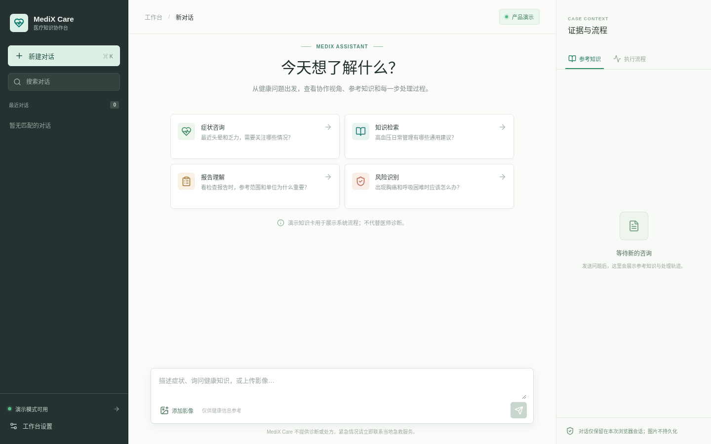
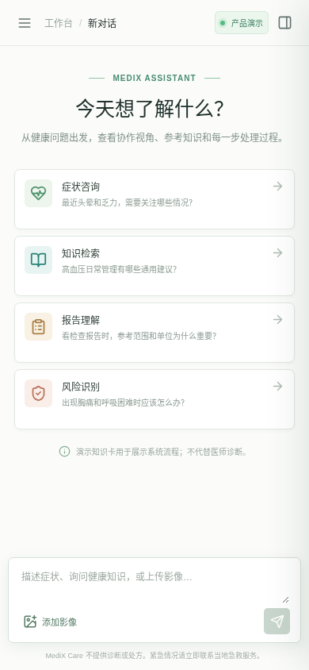

# MediX Care

面向医疗知识问答的开源产品原型。左侧管理会话，中间提问和查看回答，右侧查看知识卡与 Agent 执行轨迹。支持文本问答、图片上传、单任务路由、并行任务协作和可选的 OpenAI-compatible 模型接入。

> **不是医疗器械或诊疗服务。** 默认演示模式使用 10 张通用知识卡，不调用真实模型，不分析图片。回答仅用于展示交互与工程流程，不能用于诊断、处方或紧急决策。



<details><summary>手机端预览</summary>



</details>

## 运行

需要 Python 3.10+ 和 Node.js 20+。

```bash
python3 -m venv .venv
.venv/bin/pip install -r backend/requirements.txt
cd frontend && npm ci && npm run build && cd ..
.venv/bin/uvicorn backend.app.main:app --host 127.0.0.1 --port 8008
```

打开 `http://127.0.0.1:8008`。开发时可同时运行 `cd frontend && npm run dev`，前端地址通常为 `http://127.0.0.1:5173`，`/api` 代理到 8008。

Docker：

```bash
docker build -t medix-care .
docker run --rm -p 8008:8008 medix-care
```

## 架构

```text
React 工作台 -> FastAPI /api/chat -> Lead 关键词路由
                                        | 单任务：健康咨询 / 症状分析 / 循证检索
                                        | 多任务：asyncio 并发执行并汇总
                                        + BM25 + jieba 演示知识卡
```

这里的“Swarm”是 **Lead 编排的并行子任务**，不是去中心化、自主协商的多智能体系统。默认输出是确定性的演示文案；知识卡不是临床指南库，也没有接入训练仓库里的 9B/2B 权重。项目结构参考本地医疗助手项目的路由、检索与汇总流程，但为公开产品独立实现。

## 接入模型

将 `.env.example` 中的变量设置在服务端环境。`MEDIX_MODE=live` 时必须配置 `MEDIX_ACCESS_TOKEN`、`MEDIX_MODEL_BASE_URL`、`MEDIX_MODEL_NAME` 和 `MEDIX_MODEL_API_KEY`。模型端点须兼容 `/chat/completions`；仅当模型实际支持 OpenAI-compatible 图像输入时设置 `MEDIX_MODEL_SUPPORTS_VISION=true`。前端设置中输入访问口令，模型密钥只在服务端使用。

实时模式中的问题、历史消息及上传图片会发往你配置的模型服务。**不要**把真实患者资料提交到公开实例或未经合规评估的第三方模型。正式上线还需独立完成医疗合规、隐私告知、来源可追溯的知识库、临床评测、访问控制、速率限制、审计与错误监控。当前原型不承诺医疗准确性。

## 隐私和限制

- 服务端不持久化请求；前端文本会话暂存于浏览器 `sessionStorage`，关闭浏览器会话后清除。图片只在当前页面内存中显示，不写入会话存储。
- 导出文本记录由用户主动在浏览器本地生成，不包含图片。请勿在共享电脑中输入患者信息。
- 只接受 5 MB 以内的 JPEG、PNG、WebP；演示模式会明确说明未分析图片。
- 风险提示依赖关键词，可能误报或漏报；不能替代临床分诊。

## 测试

```bash
.venv/bin/python -m unittest discover -s backend/tests -v
cd frontend && npm run build
```

## 公开发布

本目录可作为**独立 GitHub 仓库**。不要上传上级 `medix/` 目录、原始问诊数据、模型权重、PDF 简历或 `pro1/config.py`。发布前先撤销旧工程中已经暴露的 API 密钥，并在 GitHub 仓库设置中开启 secret scanning 与 Dependabot。

```bash
git init
git add .
git status --short
git commit -m "Initial MediX Care product prototype"
git branch -M main
git remote add origin git@github.com:YOUR_ACCOUNT/medix-care.git
git push -u origin main
```

创建公开仓库后，将 `YOUR_ACCOUNT` 替换为实际账号；首次推送之前检查 `git status` 和 `git diff --cached --name-only`。本仓库代码按 MIT 许可发布，医疗内容与服务适用性由部署者自行评估。
